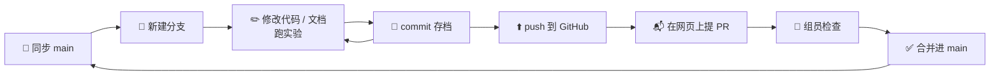

<div align="center">

# 🤝 协作指南

**第一次用 Git？没关系。** 跟着本页从上往下做一遍，大约 15 分钟就能上手。

[README](README.md) · [报告素材 doc.md](doc.md) · [GitHub 仓库](https://github.com/screenpandar/dog_cat_recognization)

</div>

---

## 📌 先记住三条规则

| | 规则 | 为什么 |
|:-:|---|---|
| 1️⃣ | **不要直接改 `main` 分支**。每项任务新建一个自己的分支，做完提 Pull Request（PR）合并 | `main` 是大家共用的"正式版"，必须保证随时能运行 |
| 2️⃣ | **开始干活前先同步 `main`**（`git pull`） | 拿到别人的最新改动，减少冲突 |
| 3️⃣ | **不要提交数据集和模型权重**（`datasets/`、`*.pt`） | 文件太大，GitHub 会拒绝；`.gitignore` 已经自动排除，不要用 `git add -f` 强行添加 |

---

## 🧭 Git 是什么？（30 秒版）

把 Git 想象成**带存档功能的共享文件夹**：

| 概念 | 打个比方 |
|---|---|
| **仓库（repository）** | 整个项目文件夹，带有全部历史存档 |
| **提交（commit）** | 存一次档，并写一句话说明改了什么 |
| **分支（branch）** | 复制出一条平行世界线，在里面随便改，不影响别人 |
| **推送（push）** | 把本地的存档上传到 GitHub |
| **拉取（pull）** | 把 GitHub 上别人的新存档下载到本地 |
| **Pull Request（PR）** | 申请"把我分支里的改动合并进 main"，其他人可以先看一眼再同意 |

整体流程如下：



---

## 🛠️ 一次性准备（只做一次）

### 1. 安装 Git

- **Windows**：下载 [Git for Windows](https://git-scm.com/download/win)，安装时一路默认即可。装完后，在开始菜单打开 **Git Bash** 或 PowerShell 都能用。
- **macOS**：终端运行 `git --version`，如果没装会提示安装。

### 2. 告诉 Git 你是谁

名字和邮箱会显示在每次提交上，**邮箱请用注册 GitHub 的那个**：

```bash
git config --global user.name "你的GitHub用户名"
git config --global user.email "你的GitHub邮箱"
```

### 3. 获得仓库权限

把你的 GitHub 用户名发给仓库管理员（screenpandar）。管理员在 **Settings → Collaborators → Add people** 里邀请你，你去邮箱点接受邀请。

### 4. 把仓库下载到本地（clone）

先进入你想放项目的文件夹，再执行：

```bash
git clone https://github.com/screenpandar/dog_cat_recognization.git
cd dog_cat_recognization
```

第一次和 GitHub 交互（clone 或 push）时可能会弹出登录窗口，按提示在浏览器里授权即可。

### 5. 配置运行环境、准备数据

按 [README · 快速开始](README.md#-快速开始) 操作：用 conda 建环境，按自己的显卡安装 PyTorch，`pip install -r requirements.txt`，然后把数据集解压到 `datasets/`。

> 💡 **不想用命令行？** 可以用图形界面：[GitHub Desktop](https://desktop.github.com/) 或 VS Code 左侧的"源代码管理"面板，下面每一步都有对应的按钮。但建议至少把命令看懂一遍，出问题时更容易排查。

---

## 🔁 日常工作流（每项任务都这样做）

下面以"同学 C 开始做 CIFAR-10"为例。

### 第 1 步：同步最新的 main

```bash
git switch main
git pull
```

### 第 2 步：新建自己的分支

```bash
git switch -c c/cifar10-baseline
```

`-c` 表示新建（create）并切换过去。之后的修改都只发生在这个分支上，不会影响 `main`。

**分支命名规范**：`<你的角色>/<简短描述>`，全小写，单词之间用 `-` 连接。

| 角色 | 示例 |
|---|---|
| 用户（猫狗实验） | `a/lr-ablation`、`a/analyze-script`、`a/final-submission` |
| 同学 B（文献 / 报告） | `b/literature-survey`、`b/report-template` |
| 同学 C（CIFAR-10） | `c/cifar10-baseline`、`c/imbalance` |

随时可以确认自己在哪个分支上：

```bash
git branch
```

带 `*` 的那一行就是当前所在的分支。

### 第 3 步：修改、跑实验

正常写代码、改文档、跑实验。跑实验时请注意：
- **`exp_name` 要唯一**，最好带上自己的前缀（如 `exp_name=c_cifar10_r18`），避免覆盖别人的 `outputs/`。
- 新实验尽量写成 `configs/` 下的一个 yaml 文件，方便别人复现。

### 第 4 步：存档（commit）

先看看改了哪些文件：

```bash
git status
```

- 红色：已修改但还没加入暂存区
- 绿色：已加入暂存区，下次 commit 会包含
- ⚠️ 如果看到 `datasets/` 或 `.pt` 文件，**不要 add**，在群里问一下

把要提交的文件加入暂存区，然后提交：

```bash
git add src/data.py configs/cifar10_r18.yaml
git commit -m "Add CIFAR-10 data loader and config"
```

确定所有改动都要提交时，也可以用 `git add .` 一次全部加入。

**一个功能存一次档**，不要攒一大堆改动才 commit。commit 信息用一句话说清楚做了什么：

| ✅ 好 | ❌ 不好 |
|---|---|
| `Add lr=1e-2 experiment results` | `update` |
| `Fix crash when train_per_class is set` | `改了一下` |
| `Write section a(1) problem definition` | `asdf` |

中文或英文都可以，组内统一就好。

### 第 5 步：推送分支到 GitHub

```bash
git push -u origin c/cifar10-baseline
```

第一次推送新分支要带 `-u origin <分支名>`；之后在这个分支上再推送，只需要：

```bash
git push
```

### 第 6 步：在网页上提 Pull Request

1. 打开 [仓库页面](https://github.com/screenpandar/dog_cat_recognization)。push 之后顶部通常会出现黄色提示条 **"c/cifar10-baseline had recent pushes"**，点 **Compare & pull request**。
   没看到提示条的话：点 **Pull requests → New pull request**，`base` 选 `main`，`compare` 选你的分支。
2. 填写标题和说明，可以参考下面的模板。
3. 右侧 **Reviewers** 选一位组员。
4. 点 **Create pull request**。

**PR 说明模板**（复制后修改）：

```markdown
## 做了什么
- 新增 CIFAR-10 数据加载（src/data.py 中的 build_cifar10_loaders）
- 新增 configs/cifar10_r18.yaml

## 结果
- CIFAR-10 test acc：xx.xx%（outputs/c_cifar10_r18_s42/）

## 怎么验证
python src/train.py --config configs/cifar10_r18.yaml --set epochs=1

## 对应报告题目
g
```

### 第 7 步：检查与合并

- **Reviewer**：在 PR 页面的 **Files changed** 里看改动；有问题就在对应行上留言，没问题就点 **Review changes → Approve**。
- **作者**：如果收到修改意见，在**同一个分支**上继续修改、commit、push，PR 会自动更新，不需要重新提。
- 审核通过后，点 **Merge pull request → Confirm merge**，然后点 **Delete branch** 删除远程分支。

### 第 8 步：回到 main，准备下一个任务

```bash
git switch main
git pull
git branch -d c/cifar10-baseline
```

最后一条删除本地已经合并的分支。下一个任务从第 2 步开始，新建一个新分支。

---

## 📋 命令速查

| 想做什么 | 命令 |
|---|---|
| 看当前状态（在哪个分支、改了什么） | `git status` |
| 看所有本地分支 | `git branch` |
| 切换到已有分支 | `git switch 分支名` |
| 新建并切换分支 | `git switch -c 分支名` |
| 拉取最新代码 | `git pull` |
| 看具体改了哪些内容 | `git diff` |
| 加入暂存区 | `git add 文件名` 或 `git add .` |
| 提交 | `git commit -m "说明"` |
| 推送 | `git push`（新分支第一次推送：`git push -u origin 分支名`） |
| 看提交历史 | `git log --oneline --graph` |

---

## 🆘 遇到问题怎么办

<details>
<summary><b>❓ 我忘了建分支，直接在 main 上改了（还没 commit）</b></summary>

没关系，直接新建分支，未提交的改动会跟着一起带过去：

```bash
git switch -c a/my-feature
```

然后照常 add、commit、push。
</details>

<details>
<summary><b>❓ 我在 main 上已经 commit 了（还没 push）</b></summary>

先把这些提交"搬"到一个新分支上，再把本地 main 恢复成和远程一致：

```bash
git branch a/my-feature
git reset --hard origin/main
git switch a/my-feature
```

⚠️ 执行前先用 `git status` 确认没有未提交的改动，因为 `reset --hard` 会丢弃它们。不确定的话，先在群里问一下。
</details>

<details>
<summary><b>❓ 切换分支时报错 "Your local changes would be overwritten"</b></summary>

说明你有没提交的改动。两种处理方式：

- 改动要保留：先 `git add .`，再 `git commit -m "WIP"`，然后切换分支。
- 改动先暂存起来，稍后再用：

```bash
git stash
git switch 其他分支
# ……之后回到原分支……
git stash pop
```
</details>

<details>
<summary><b>❓ push 时报错 "rejected … fetch first" 或 "non-fast-forward"</b></summary>

远程分支上有你本地没有的新提交。先拉取再推送：

```bash
git pull
git push
```
</details>

<details>
<summary><b>❓ PR 页面显示 "This branch has conflicts"（冲突）</b></summary>

说明你和别人改了同一个文件的同一处。把最新的 main 合并进你的分支，手动解决冲突：

```bash
git switch main
git pull
git switch 你的分支
git merge main
```

Git 会提示哪些文件有冲突。打开这些文件，会看到这样的标记：

```
<<<<<<< HEAD
你的版本
=======
main 上的版本
>>>>>>> main
```

把它改成最终想要的内容（删掉 `<<<<<<<`、`=======`、`>>>>>>>` 这三行标记），然后：

```bash
git add 冲突的文件
git commit -m "Resolve merge conflict with main"
git push
```

VS Code 打开冲突文件时会显示 "Accept Current / Accept Incoming / Accept Both" 按钮，点选会更方便。
</details>

<details>
<summary><b>❓ 不小心 add 了不该提交的文件（还没 commit）</b></summary>

```bash
git restore --staged 文件名
```

这只是把文件移出暂存区，文件本身不会被删除。
</details>

<details>
<summary><b>❓ push 时报错 "File … exceeds GitHub's file size limit of 100 MB"</b></summary>

说明有大文件（数据集或权重）被提交了。**不要反复重试**，在群里找管理员处理。这类问题需要改写提交历史。
</details>

---

## 🗂️ 各自放文件的位置

| 内容 | 放在哪里 | 负责 |
|---|---|---|
| 猫狗实验配置 | `configs/*.yaml` | 用户 |
| CIFAR-10 数据加载 | `src/data.py` 中新增函数（不要改动猫狗用的 `build_loaders` 的行为） | C |
| CIFAR-10 配置 | `configs/cifar10_*.yaml` | C |
| 实验输出 | `outputs/<exp_name>_s<seed>/`，`exp_name` 带上自己的前缀 | 各自 |
| 报告素材 | `doc.md` 中对应的题目（a 题 B，g/h 题 C，其余用户） | 各自 |

修改公共代码（`src/train.py`、`src/models.py`、`src/utils.py`）前，请先在群里说一声，避免两个人同时改出冲突。

---

## 🔒 给仓库管理员：保护 main 分支（建议设置）

为了确保大家都走 PR 流程，可以在 GitHub 上设置规则，禁止直接 push 到 `main`：

1. 打开仓库 **Settings → Rules → Rulesets → New ruleset → New branch ruleset**
2. **Ruleset name** 填 `protect-main`，**Enforcement status** 选 `Active`
3. **Target branches** → **Add target** → **Include default branch**
4. 勾选 **Restrict deletions**、**Block force pushes**、**Require a pull request before merging**（Required approvals 可以设为 1）
5. 点 **Create**

> 免费的私有仓库可能不支持这项设置。不支持的话，就靠大家自觉遵守上面的三条规则。

---

<div align="center">
<sub>有问题随时在群里问，宁可多问一句，也不要硬改 main 😉</sub>
</div>
